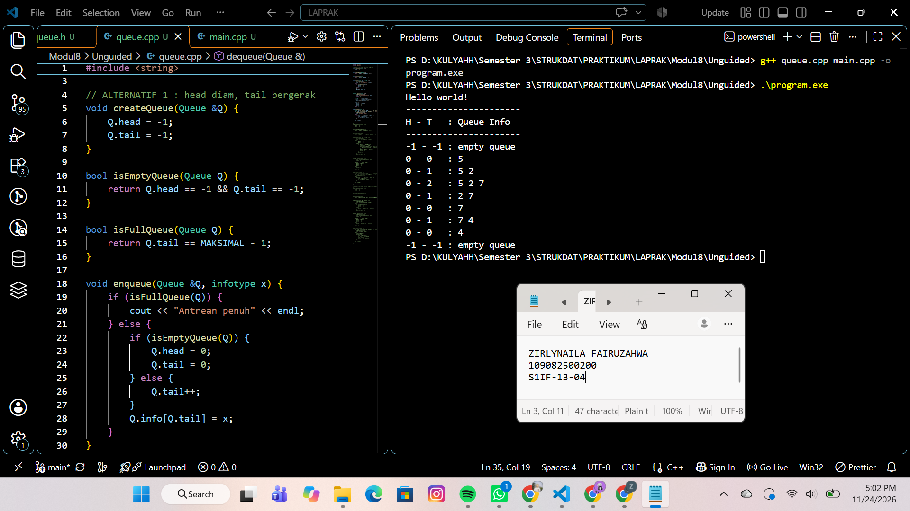
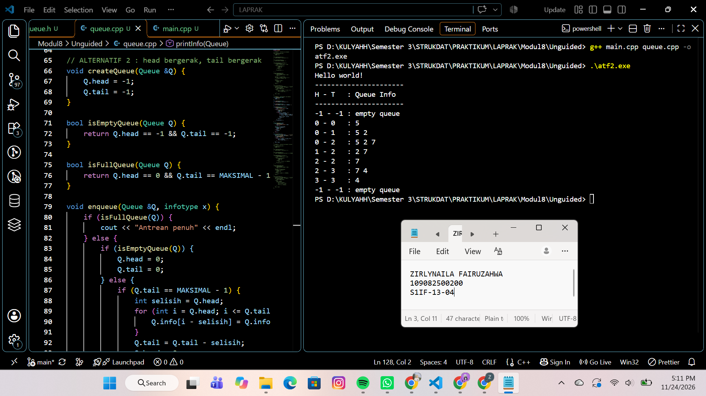
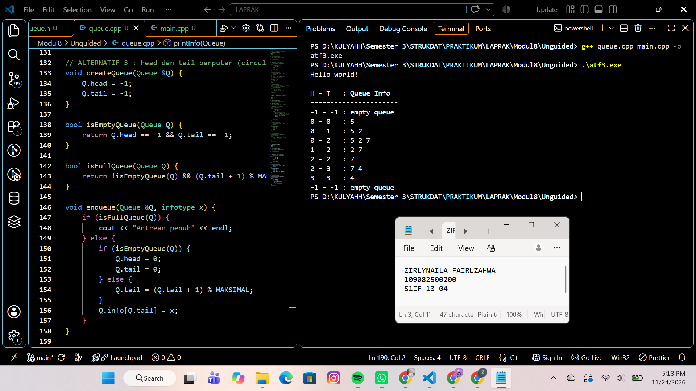

# <h1 align="center">Laporan Praktikum Modul 8 - QUEUE</h1>

<p align="center">Zirlynaila Fairuzahwa - 109082500200</p>

## Dasar Teori

Queue merupakan salah satu struktur data linear yang digunakan untuk menyimpan dan mengelola sekumpulan elemen berdasarkan prinsip FIFO (First In, First Out), yaitu elemen yang pertama kali dimasukkan akan menjadi elemen pertama yang dikeluarkan. Struktur data Queue dapat diumpamakan seperti antrean pembelian tiket, ketika orang yang datang terlebih dahulu akan mendapatkan pelayanan terlebih dahulu. Dalam pemrograman, Queue digunakan untuk mengatur urutan pemrosesan data agar berlangsung secara teratur. Implementasi Queue dapat menggunakan Array maupun Linked List [1][2].

### A. Queue dengan Representasi Linked List<br/>

Queue dengan representasi Linked List merupakan implementasi struktur data Queue yang menggunakan elemen-elemen yang saling terhubung melalui pointer. Setiap elemen memiliki bagian untuk menyimpan informasi (info) dan pointer (next) yang menunjukkan alamat elemen berikutnya. Implementasi ini menggunakan dua pointer utama, yaitu Head dan Tail, untuk menunjukkan posisi awal dan akhir antrean. Penggunaan Linked List memberikan fleksibilitas dalam pengelolaan elemen karena penambahan dan penghapusan data dilakukan melalui pengaturan hubungan pointer [1][5].

#### 1. Pengertian dan Komponen Queue
Queue merupakan struktur data yang menerapkan prinsip FIFO (First In, First Out), yaitu elemen yang pertama kali masuk akan menjadi elemen pertama yang keluar. Queue memiliki dua bagian utama, yaitu Head yang menunjukkan elemen pertama dan Tail yang menunjukkan elemen terakhir. Komponen Queue dengan representasi Linked List terdiri dari Node sebagai tempat penyimpanan data, Info untuk menyimpan informasi, Next sebagai pointer ke elemen berikutnya, Head sebagai penunjuk elemen pertama, Tail sebagai penunjuk elemen terakhir, serta Nil (NULL) yang menunjukkan bahwa pointer tidak menunjuk ke elemen mana pun. Pada Queue kosong, Head dan Tail bernilai Nil.

#### 2. Operasi Dasar Queue (Enqueue dan Dequeue)
Operasi dasar Queue terdiri dari Enqueue dan Dequeue. Enqueue merupakan operasi penambahan elemen yang dilakukan pada bagian akhir atau Tail. Prosesnya dimulai dengan membuat elemen baru melalui alokasi memori, mengatur pointer Next menjadi Nil, menghubungkan elemen terakhir dengan elemen baru, kemudian memperbarui Tail agar menunjuk ke elemen tersebut. Sementara itu, Dequeue merupakan operasi penghapusan elemen yang dilakukan pada bagian awal atau Head dengan menyimpan alamat elemen pertama, memindahkan Head ke elemen berikutnya, mengatur pointer Next elemen yang dihapus menjadi Nil, dan mengembalikan alamat elemen tersebut. Kedua operasi tersebut mempertahankan prinsip FIFO dalam pengelolaan data.

#### 3. Primitif-Primitif dalam ADT Queue
ADT (Abstract Data Type) Queue merupakan pendefinisian struktur data Queue beserta operasi-operasi yang digunakan untuk mengelola elemen di dalamnya. Primitif-primitif Queue disimpan dalam file berekstensi .h dan .c, yang meliputi isEmpty() untuk memeriksa Queue kosong, CreateQueue() untuk membentuk Queue kosong, alokasi() untuk menyediakan memori elemen baru, dealokasi() untuk membebaskan memori, findElm() untuk mencari elemen berdasarkan nilai informasi, fFindElm() untuk mencari elemen berdasarkan alamat, insert() untuk menambahkan elemen pada akhir Queue, delete() untuk menghapus elemen pertama, printInfo() untuk menampilkan seluruh elemen, nbList() untuk menghitung jumlah elemen, serta delAll() untuk menghapus seluruh elemen dan membebaskan memorinya.

### B. Queue dengan Representasi Tabel (Array)<br/>

Queue dengan representasi tabel merupakan implementasi struktur data Queue yang menggunakan Array sebagai tempat penyimpanan elemen. Representasi ini menggunakan indeks Head dan Tail untuk menunjukkan posisi elemen pertama dan terakhir dalam antrean. Berbeda dengan representasi Linked List, Queue menggunakan tabel memiliki jumlah elemen terbatas sesuai kapasitas Array dan tidak memerlukan pengelolaan memori secara dinamis. Dalam representasi tabel, terdapat tiga alternatif pengelolaan posisi Head dan Tail, yaitu Head diam dan Tail bergerak, Head dan Tail bergerak, serta Head dan Tail berputar [2][3].

#### 1. Karakteristik dan Alternatif 1 Queue
Queue dengan representasi tabel memiliki kapasitas penyimpanan yang terbatas sesuai ukuran Array dan tidak memerlukan pengelolaan memori secara dinamis. Alternatif 1 merupakan mekanisme Queue dengan Head diam dan Tail bergerak, yaitu Head selalu berada pada indeks 1 ketika Queue tidak kosong, sedangkan Tail menunjukkan indeks elemen terakhir. Penambahan elemen dilakukan dengan memajukan Tail selama masih tersedia tempat. Sementara itu, penghapusan dilakukan dengan mengambil elemen pada posisi Head, kemudian menggeser seluruh elemen berikutnya satu posisi ke depan dan memundurkan Tail. Mekanisme ini menyebabkan proses penghapusan kurang efisien karena membutuhkan penggeseran elemen.

#### 2. Alternatif 2 Queue (Head Bergerak dan Tail Bergerak)
Queue Alternatif 2 merupakan mekanisme Queue yang menggunakan Head dan Tail sebagai indeks yang dapat bergerak sesuai operasi penambahan dan penghapusan elemen. Penambahan elemen dilakukan dengan memajukan Tail, sedangkan penghapusan dilakukan dengan mengambil elemen pada posisi Head kemudian memajukan Head ke posisi berikutnya. Mekanisme ini tidak memerlukan penggeseran elemen setiap kali penghapusan dilakukan sehingga lebih efisien dibandingkan Alternatif 1. Namun, dapat terjadi kondisi Queue penuh semu, yaitu ketika Tail telah mencapai indeks maksimum meskipun masih terdapat ruang kosong pada bagian awal Array. Untuk mengatasi kondisi tersebut, elemen perlu digeser kembali ke bagian awal Array apabila Tail telah mencapai IndexMax.

#### 3. Alternatif 3 Queue (Head dan Tail Berputar) serta Primitif ADT Queue
Queue Alternatif 3 merupakan mekanisme Queue yang menggunakan Head dan Tail dengan indeks yang berputar dari awal hingga akhir Array, kemudian kembali ke posisi awal. Mekanisme ini dikenal sebagai Circular Queue atau Queue melingkar. Apabila Tail mencapai IndexMax, posisi berikutnya kembali ke indeks 1. Hal yang sama berlaku pada Head ketika proses penghapusan dilakukan. Mekanisme ini tidak memerlukan penggeseran elemen sehingga penggunaan ruang penyimpanan lebih efisien [3]. Primitif-primitif dalam ADT Queue representasi tabel meliputi isFull() untuk memeriksa Queue penuh, isEmpty() untuk memeriksa Queue kosong, CreateQueue() untuk membentuk Queue kosong, enQueue() untuk menambahkan elemen, deQueue() untuk menghapus elemen pertama, dan viewQueue() untuk menampilkan seluruh informasi elemen dalam Queue. Selain itu, terdapat variasi penggunaan COUNT sebagai pengganti Tail untuk menunjukkan jumlah elemen yang tersimpan dalam Queue.

## Guided

### 1. QUEUE dengan LINKED LIST

```C++
source code queue.h

#ifndef QUEUE_H
#define QUEUE_H

#include <iostream>
#include <string>
using namespace std;

struct Node
{
    string nama;
    Node *next;
};

struct queue
{
    Node *head, *tail;
};

void CreateQueue(queue &Q);
bool isEmpty(queue Q);
bool isFull(queue Q);
void enQueue(queue &Q, const string &nama);
void deQueue(queue &Q);
void viewQueue(queue Q);
void clearQueue(queue &Q);
#endif
```

Code queue.h berisi deklarasi tipe data, struktur node, struktur queue, serta operasi fungsi dan prosedur yang digunakan dalam Queue dengan representasi pointer (Singly Linked List). Struktur Node menyimpan data berupa string pada nama dan pointer next untuk menunjuk node di belakangnya, sedangkan struktur queue memiliki dua pointer, yaitu head yang menunjuk node paling depan dan tail yang menunjuk node paling belakang. Selain itu, kode ini mendeklarasikan berbagai operasi untuk membuat queue kosong (CreateQueue), mengecek kondisi kosong dan penuh (isEmpty dan isFull), menyisipkan data di belakang queue (enQueue), mengambil data dari depan queue (deQueue), menampilkan seluruh isi queue (viewQueue), serta menghapus seluruh isi queue (clearQueue). Include guard QUEUE_H digunakan agar file header tidak di-include lebih dari satu kali.

```C++
source code queue.cpp

#include "queue.h"

void CreateQueue(queue &Q)
{
    Q.head = Q.tail = nullptr;
}

bool isEmpty(queue Q)
{
    return Q.head == nullptr && Q.tail == nullptr;
}

bool isFull(queue Q)
{
    int maxQueue = 20; 
    int counter = 0;
    Node *nodeBantu = Q.head;
    
    while (nodeBantu != Q.tail)
    {
        counter++;
        nodeBantu->next;
    }
    
    return counter >= maxQueue;
}

void enQueue(queue &Q, const string &nama)
{
    if (isEmpty(Q))
    {
        Node *nodeBaru = new Node{nama, nullptr};
        Q.head = Q.tail = nodeBaru;
    }
    else
    {
        Node *nodeBaru = new Node{nama, nullptr};
        Q.tail->next = nodeBaru;
        Q.tail = nodeBaru;
    }
}

void deQueue(queue &Q)
{
    if (isEmpty(Q))
    {
        cout << "Queue kosong";
    }
    else
    {
        Node *nodeHapus = Q.head;
        Q.head = Q.head->next;
        delete nodeHapus;
    }
}

void viewQueue(queue Q)
{
    if (isEmpty(Q))
    {
        cout << "Queue kosong";
    }
    else
    {
        Node *nodeBantu = Q.head;

        while (nodeBantu != nullptr)
        {
            cout << "Nama :  " << nodeBantu->nama;
            nodeBantu = nodeBantu->next;
        }
    }
}

void clearQueue(queue &Q)
{
    if (isEmpty(Q))
    {
        cout << "Queue kosong";
    }
    else
    {
        Node *nodeHapus = Q.head;

        while (nodeHapus != nullptr)
        {
            nodeHapus = nodeHapus->next;
            deQueue(Q);
        }
    }
}
```

Code queue.cpp berisi implementasi dari seluruh operasi yang dideklarasikan pada queue.h untuk Queue representasi pointer. Prosedur CreateQueue() membuat queue kosong dengan mengisi head dan tail dengan nullptr, dan fungsi isEmpty() mengembalikan true jika head dan tail sama-sama bernilai nullptr. Fungsi isFull() menelusuri node dari head menggunakan nodeBantu sambil menambah counter, lalu mengembalikan true jika counter sudah mencapai batas maxQueue yaitu 20. Prosedur enQueue() membuat node baru dengan new, kemudian jika queue kosong maka head dan tail diarahkan ke node baru, sedangkan jika tidak kosong maka Q.tail->next diarahkan ke node baru lalu tail dipindahkan ke node baru (sama dengan insert last). Prosedur deQueue() menyimpan head ke nodeHapus, menggeser head ke node berikutnya, lalu menghapus node tersebut dengan delete (sama dengan delete first), dan menampilkan pesan "Queue kosong" jika tidak ada elemen. Prosedur viewQueue() menelusuri queue dari head sampai nullptr dan menampilkan tulisan "Nama : " diikuti isi nama pada setiap node. Prosedur clearQueue() menelusuri queue dengan nodeHapus dan memanggil deQueue() pada setiap langkah sampai seluruh node terhapus.

```C++
source code main.cpp

#include "queue.h"
#include <iostream>
using namespace std;

int main()
{
    queue Q;
    CreateQueue(Q);

    enQueue(Q, "Gilar ");
    enQueue(Q, "Aflah ");
    enQueue(Q, "Aedil ");
    enQueue(Q, "Fathir ");
    enQueue(Q, "Kevin ");
    enQueue(Q, "Zulfa");
    cout << endl;

    cout << "--- Isi Queue Setelah enQueue ---" << endl;
    viewQueue(Q);

    deQueue(Q);
    deQueue(Q);
    deQueue(Q);
    deQueue(Q);
    cout << endl;

    cout << "--- Isi Queue Setelah deQueue ---" << endl;
    viewQueue(Q);

    clearQueue(Q);
    return 0;
}
```

Code main.cpp digunakan untuk menjalankan dan menguji operasi Queue pada queue.h dan queue.cpp. Pertama, program membuat queue kosong dengan CreateQueue(), lalu melakukan enQueue() untuk nama Gilar, Aflah, Aedil, Fathir, Kevin, dan Zulfa secara berurutan sehingga isi queue dari depan menjadi Gilar, Aflah, Aedil, Fathir, Kevin, Zulfa, kemudian ditampilkan dengan viewQueue() di bawah tulisan "--- Isi Queue Setelah enQueue ---". Setelah itu, deQueue() dijalankan sebanyak empat kali sehingga Gilar, Aflah, Aedil, dan Fathir keluar sesuai prinsip FIFO dan isi queue menjadi Kevin dan Zulfa, lalu ditampilkan kembali dengan viewQueue() di bawah tulisan "--- Isi Queue Setelah deQueue ---". Terakhir, clearQueue() dipanggil untuk menghapus seluruh node yang tersisa dari memori.

### 2. QUEUE dengan ARRAY

```C++
source code queue.h

#ifndef QUEUE_H
#define QUEUE_H

#include <iostream>
using namespace std;

const int MAKSIMAL = 5;

struct queue {
    string nama[MAKSIMAL];
    int head;
    int tail;
};

bool isFull(queue Q);
bool isEmpty(queue Q);
void CreateQueue(queue &Q);
void enQueue(queue &Q, string nama);
void deQueue(queue &Q);
void viewQueue(queue Q);

#endif
```

Code queue.h berisi deklarasi tipe data, struktur queue, serta operasi fungsi dan prosedur yang digunakan dalam Queue dengan representasi tabel (array). Konstanta MAKSIMAL bernilai 5 menyatakan kapasitas maksimum queue, sedangkan struktur queue menyimpan array nama berukuran MAKSIMAL sebagai tempat elemen queue, variabel head sebagai indeks elemen paling depan, dan variabel tail sebagai indeks elemen paling belakang. Selain itu, kode ini mendeklarasikan operasi untuk mengecek kondisi penuh dan kosong (isFull dan isEmpty), membuat queue kosong (CreateQueue), menyisipkan data di belakang queue (enQueue), mengambil data dari depan queue (deQueue), serta menampilkan seluruh isi queue (viewQueue). Include guard QUEUE_H digunakan agar file header tidak di-include lebih dari satu kali.

```C++
source code queue.cpp

#include "queue.h"
#include <iostream>

using namespace std;

// NOTE : 
// Implementasi 1 = head diam, tail bergerak (Queue Linear Statis, kerana head nya tetap diam)
// Implementasi 2 = head bergerak, tail bergerak (Queue Linear Dinamis, karena head & tail nya sama-sama bergerak)
// Implementasi 3 = head dan tail berputar (Queue Circular, karena jika udh mentok tapi masih ada space, diputar sehingga tail bisa ada didepan head)

bool isEmpty(queue Q){
    if(Q.head == -1 && Q.tail == -1){
        return true;
    } else {
        return false;
    }
}

//isFull implmenetasi 1 & 2
bool isFull(queue Q){
    if(Q.tail == MAKSIMAL - 1){
        return true;
    } else {
        return false;
    }
}

// isFull implementasi 3
bool isFull(queue Q){
    if((Q.tail + 1) % MAKSIMAL == Q.head){
        return true;
    } else {
        return false;
    }
}

void CreateQueue(queue &Q){ //terbentuk queue dengan head = -1 dan tail = -1 
    Q.head = -1;
    Q.tail = -1;
}
 

//enqueue implementasi 1 & 2
void enQueue(queue &Q, string nama){
    if(isFull(Q) == true){
        cout << "Queue sudah penuh!" << endl;
    } else {
        if(isEmpty(Q) == true){
            Q.head = Q.tail = 0;
        } else {
            Q.tail++;
        }
        Q.nama[Q.tail] = nama;
        cout << "nama " << nama << " berhasil ditambahkan kedalam queue!" << endl;
    }
}

// enQueue implementasi 3
void enQueue(queue &Q, string nama){
    if(isFull(Q) == true){
        cout << "Queue sudah penuh!" << endl;
    } else {
        if(isEmpty(Q) == true){
            Q.head = Q.tail = 0;
        } else {
            Q.tail = (Q.tail + 1) % MAKSIMAL; // bergerak melingkar
        }
        Q.nama[Q.tail] = nama;
        cout << "nama " << nama << " berhasil ditambahkan kedalam queue!" << endl;
    }
}

// dequeue implementasi 1
void deQueue(queue &Q){
    if(isEmpty(Q) == true){
        cout << "Queue kosong!" << endl;
    } else {
        cout << "Mengahapus data " << Q.nama[Q.head] << "..." << endl;
        for(int i = 0; i < Q.tail; i++){
            Q.nama[i] =  Q.nama[i+1];
        }
        Q.tail--;
        if(Q.tail < 0){ //kalo semua isi queue nya udh dikeluarin, set head & tail ke -1
            Q.head = -1;
            Q.tail = -1;
        }
    }
}

// dequeue implementasi 2
void deQueue(queue &Q){
    if(isEmpty(Q) == true){
        cout << "Queue kosong!" << endl;
    } else {
        cout << "Mengahapus data " << Q.nama[Q.head] << "..." << endl;
        Q.head++;
        if(Q.head > Q.tail){ //kalo elemennya udh abis (head akan lebih 1 dari tail), maka reset ulang head & tail ke -1
            Q.head = -1;
            Q.tail = -1;
        }
    }
}

// deQueue implementasi 3
void deQueue(queue &Q){
    if(isEmpty(Q) == true){
        cout << "Queue kosong!" << endl;
    } else {
        cout << "Mengahapus data " << Q.nama[Q.head] << "..." << endl;
        if(Q.head == Q.tail){ //kalo elemennya tinggal 1, langsungkan saja head & tail nya reset ke -1
            Q.head = -1;
            Q.tail = -1;
        } else {
            Q.head = (Q.head + 1) % MAKSIMAL; // bergerak melingkar
        }
    }
}

// viewQueue implementasi 1 & 2
void viewQueue(queue Q){
    if(isEmpty(Q) == true){
        cout << "Queue kosong!" << endl;
    } else {
        for(int i = Q.head; i <= Q.tail; i++){
            cout << i -  Q.head + 1 << ". " << Q.nama[i] << endl;
        }
    }
    cout << endl;
}

// viewQueue implementasi 3
void viewQueue(queue Q){
    if(isEmpty(Q) == true){
        cout << "Queue kosong!" << endl;
    } else {
        int i = Q.head;
        int count = 1;
        while(true){
            cout << count << ". " << Q.nama[i] << endl;
            if(i == Q.tail){
                break;
            }
            i = (i + 1) % MAKSIMAL;
            count++;
        }   
    }
}
```

Code queue.cpp berisi implementasi dari seluruh operasi yang dideklarasikan pada queue.h untuk Queue representasi tabel, dengan tiga alternatif mekanisme yaitu Implementasi 1 (head diam, tail bergerak), Implementasi 2 (head bergerak, tail bergerak), dan Implementasi 3 (head dan tail berputar), di mana hanya satu implementasi yang diaktifkan dalam satu waktu. Fungsi isEmpty() mengembalikan true jika head dan tail bernilai -1, dan CreateQueue() membuat queue kosong dengan mengisi head dan tail dengan -1. Pada Implementasi 1 dan 2, isFull() mengembalikan true jika tail bernilai MAKSIMAL - 1, sedangkan pada Implementasi 3 isFull() mengembalikan true jika (tail + 1) % MAKSIMAL sama dengan head. Prosedur enQueue() pada Implementasi 1 dan 2 mengisi head dan tail dengan 0 jika queue kosong, atau menambah tail dengan 1 jika tidak kosong, lalu menyimpan nama pada Q.nama[Q.tail] dan menampilkan pesan keberhasilan, dan akan menampilkan pesan "Queue sudah penuh!" jika queue sudah penuh. Pada Implementasi 3, tail dihitung dengan (Q.tail + 1) % MAKSIMAL sehingga tail kembali ke indeks 0 setelah mencapai indeks terakhir. Prosedur deQueue() pada Implementasi 1 menampilkan data yang dihapus, menggeser seluruh elemen satu indeks ke kiri, lalu mengurangi tail dengan 1, dan mengembalikan head dan tail menjadi -1 jika queue sudah habis. Pada Implementasi 2, deQueue() cukup menambah head dengan 1 tanpa menggeser elemen, dan head serta tail di-reset menjadi -1 jika head melebihi tail. Pada Implementasi 3, deQueue() menggeser head dengan (Q.head + 1) % MAKSIMAL, dan me-reset head serta tail menjadi -1 jika elemen tinggal satu. Prosedur viewQueue() pada Implementasi 1 dan 2 menampilkan isi queue dengan perulangan dari head sampai tail dengan penomoran dimulai dari 1, sedangkan pada Implementasi 3 perulangan berputar dari head dengan % MAKSIMAL sampai tail tercapai.

```C++
source code main.cpp

#include "queue.h"
#include <iostream>

using namespace std;

int main(){
    queue Q;

    CreateQueue(Q);
    enQueue(Q, "Dimas");
    enQueue(Q, "Arvin");
    enQueue(Q, "Rizal");
    enQueue(Q, "Hafizh");
    enQueue(Q, "Fathur");
    enQueue(Q, "Daffa");
    cout << endl;

    cout << "--- Isi Queue Setelah enQueue ---" << endl;
    viewQueue(Q);
    cout << endl;

    deQueue(Q);
    deQueue(Q);
    deQueue(Q);
    deQueue(Q);
    // deQueue(Q);
    // deQueue(Q);
    cout << endl;

    cout << "--- Isi Queue Setelah deQueue ---" << endl;
    viewQueue(Q);

    return 0;
}
```

Code main.cpp digunakan untuk menjalankan dan menguji operasi Queue pada queue.h dan queue.cpp. Pertama, program membuat queue kosong dengan CreateQueue(), lalu melakukan enQueue() untuk nama Dimas, Arvin, Rizal, Hafizh, Fathur, dan Daffa. Karena kapasitas queue hanya 5, lima nama pertama berhasil ditambahkan, sedangkan Daffa ditolak dengan pesan "Queue sudah penuh!", sehingga isi queue dari depan menjadi Dimas, Arvin, Rizal, Hafizh, Fathur, yang ditampilkan dengan viewQueue() di bawah tulisan "--- Isi Queue Setelah enQueue ---". Setelah itu, deQueue() dijalankan sebanyak empat kali sehingga Dimas, Arvin, Rizal, dan Hafizh keluar sesuai prinsip FIFO (dua pemanggilan deQueue lainnya dijadikan komentar), dan isi queue hanya tersisa Fathur, yang ditampilkan kembali dengan viewQueue() di bawah tulisan "--- Isi Queue Setelah deQueue ---". Posisi Fathur berbeda tergantung implementasi: pada Implementasi 1, head dan tail berada di indeks 0 karena elemen digeser, sedangkan pada Implementasi 2 dan 3, head dan tail berada di indeks 4 karena hanya head yang bergerak maju.

## Unguided

### 1. Buatlah ADT Queue menggunakan ARRAY sebagai berikut:

```C++
source code queue.h

#ifndef QUEUE_H_INCLUDE
#define QUEUE_H_INCLUDE

#include <iostream>
using namespace std;

const int MAKSIMAL = 5;
typedef int infotype;

struct Queue {
    infotype info[MAKSIMAL];
    int head, tail;
};

void createQueue(Queue &Q);
bool isEmptyQueue(Queue Q);
bool isFullQueue(Queue Q);
void enqueue(Queue &Q, infotype x);
infotype dequeue(Queue &Q);
void printInfo(Queue Q);

#endif
```

```C++
source code queue.cpp

#include <string>
#include "queue.h"

// ALTERNATIF 1 : head diam, tail bergerak
void createQueue(Queue &Q) {
    Q.head = -1;
    Q.tail = -1;
}

bool isEmptyQueue(Queue Q) {
    return Q.head == -1 && Q.tail == -1;
}

bool isFullQueue(Queue Q) {
    return Q.tail == MAKSIMAL - 1;
}

void enqueue(Queue &Q, infotype x) {
    if (isFullQueue(Q)) {
        cout << "Antrean penuh" << endl;
    } else {
        if (isEmptyQueue(Q)) {
            Q.head = 0;        
            Q.tail = 0;
        } else {
            Q.tail++; 
        }
        Q.info[Q.tail] = x;
    }
}

infotype dequeue(Queue &Q) {
    if (isEmptyQueue(Q)) {
        cout << "Antrean kosong" << endl;
        return -1;
    }
    infotype x = Q.info[Q.head];
    for (int i = Q.head; i < Q.tail; i++) {  
        Q.info[i] = Q.info[i + 1];
    }
    Q.tail--;                 
    if (Q.tail < Q.head) {                     
        Q.head = -1;
        Q.tail = -1;
    }
    return x;
}

void printInfo(Queue Q) {
    string ht = to_string(Q.head) + " - " + to_string(Q.tail);
    cout << ht << string(7 - ht.length(), ' ') << " : ";
    if (isEmptyQueue(Q)) {
        cout << "empty queue";
    } else {
        for (int i = Q.head; i <= Q.tail; i++) {
            cout << Q.info[i];
            if (i < Q.tail) cout << " ";
        }
    }
    cout << endl;
}

// ALTERNATIF 2 : head bergerak, tail bergerak
void createQueue(Queue &Q) {
    Q.head = -1;
    Q.tail = -1;
}

bool isEmptyQueue(Queue Q) {
    return Q.head == -1 && Q.tail == -1;
}

bool isFullQueue(Queue Q) {
    return Q.head == 0 && Q.tail == MAKSIMAL - 1;
}

void enqueue(Queue &Q, infotype x) {
    if (isFullQueue(Q)) {
        cout << "Antrean penuh" << endl;
    } else {
        if (isEmptyQueue(Q)) {
            Q.head = 0;
            Q.tail = 0;
        } else {
            if (Q.tail == MAKSIMAL - 1) {         
                int selisih = Q.head;
                for (int i = Q.head; i <= Q.tail; i++) {
                    Q.info[i - selisih] = Q.info[i];
                }
                Q.tail = Q.tail - selisih;
                Q.head = 0;
            }
            Q.tail++;
        }
        Q.info[Q.tail] = x;
    }
}

infotype dequeue(Queue &Q) {
    if (isEmptyQueue(Q)) {
        cout << "Antrean kosong" << endl;
        return -1;
    }
    infotype x = Q.info[Q.head];
    if (Q.head == Q.tail) {  
        Q.head = -1;
        Q.tail = -1;
    } else {
        Q.head++;                           
    }
    return x;
}

void printInfo(Queue Q) {
    string ht = to_string(Q.head) + " - " + to_string(Q.tail);
    cout << ht << string(7 - ht.length(), ' ') << " : ";
    if (isEmptyQueue(Q)) {
        cout << "empty queue";
    } else {
        for (int i = Q.head; i <= Q.tail; i++) {
            cout << Q.info[i];
            if (i < Q.tail) cout << " ";
        }
    }
    cout << endl;
}

// ALTERNATIF 3 : head dan tail berputar (circular)
void createQueue(Queue &Q) {
    Q.head = -1;
    Q.tail = -1;
}

bool isEmptyQueue(Queue Q) {
    return Q.head == -1 && Q.tail == -1;
}

bool isFullQueue(Queue Q) {
    return !isEmptyQueue(Q) && (Q.tail + 1) % MAKSIMAL == Q.head;
}

void enqueue(Queue &Q, infotype x) {
    if (isFullQueue(Q)) {
        cout << "Antrean penuh" << endl;
    } else {
        if (isEmptyQueue(Q)) {
            Q.head = 0;
            Q.tail = 0;
        } else {
            Q.tail = (Q.tail + 1) % MAKSIMAL;    
        }
        Q.info[Q.tail] = x;
    }
}

infotype dequeue(Queue &Q) {
    if (isEmptyQueue(Q)) {
        cout << "Antrean kosong" << endl;
        return -1;
    }
    infotype x = Q.info[Q.head];
    if (Q.head == Q.tail) {                   
        Q.head = -1;
        Q.tail = -1;
    } else {
        Q.head = (Q.head + 1) % MAKSIMAL;       
    }
    return x;
}

void printInfo(Queue Q) {
    string ht = to_string(Q.head) + " - " + to_string(Q.tail);
    cout << ht << string(7 - ht.length(), ' ') << " : ";
    if (isEmptyQueue(Q)) {
        cout << "empty queue";
    } else {
        int i = Q.head;
        while (true) {
            cout << Q.info[i];
            if (i == Q.tail) break;
            cout << " ";
            i = (i + 1) % MAKSIMAL;
        }
    }
    cout << endl;
}
```

```C++
source code main.cpp

#include "queue.h"

int main() {
    cout << "Hello world!" << endl;
    Queue Q;
    createQueue(Q);

    cout << "----------------------" << endl;
    cout << "H - T   : Queue Info" << endl;
    cout << "----------------------" << endl;
    printInfo(Q);
    enqueue(Q, 5); printInfo(Q);
    enqueue(Q, 2); printInfo(Q);
    enqueue(Q, 7); printInfo(Q);
    dequeue(Q); printInfo(Q);
    dequeue(Q); printInfo(Q);
    enqueue(Q, 4); printInfo(Q);
    dequeue(Q); printInfo(Q);
    dequeue(Q); printInfo(Q);

    return 0;
}
```

### Output Unguided 1 :

##### Output 1 (Alternatif 1)



##### Output 2 (Alternatif 2)



##### Output 3 (Alternatif 3)



Program tersebut digunakan untuk membuat sebuah queue dengan representasi tabel (array) yang menyimpan data integer, lalu menjalankan operasi enqueue, dequeue, dan printInfo untuk menampilkan isi queue beserta posisi head dan tail-nya. Queue bekerja dengan prinsip FIFO (First In First Out), yaitu elemen yang pertama masuk adalah elemen yang pertama keluar. Program dibagi menjadi tiga file, yaitu queue.h, queue.cpp, dan main.cpp, dan di dalam queue.cpp terdapat tiga alternatif mekanisme queue, yaitu Alternatif 1 (head diam, tail bergerak), Alternatif 2 (head bergerak, tail bergerak), dan Alternatif 3 (head dan tail berputar).
<br>
Pertama, pada queue.h dibuat tipe infotype sebagai integer, konstanta MAKSIMAL dengan nilai 5, dan struct Queue yang berisi info berupa array berukuran MAKSIMAL untuk menyimpan data serta head dan tail untuk menunjuk indeks elemen paling depan dan elemen paling belakang. Selain itu, queue.h berisi prototipe dari createQueue, isEmptyQueue, isFullQueue, enqueue, dequeue, dan printInfo.
<br>
Kedua, pada queue.cpp diimplementasikan seluruh prosedur dan fungsi tersebut. Pada Alternatif 1, prosedur createQueue() membuat queue kosong dengan mengisi Q.head dan Q.tail dengan -1, sehingga fungsi isEmptyQueue() mengembalikan true jika head dan tail sama-sama bernilai -1. Fungsi isFullQueue() mengembalikan true jika tail sudah bernilai MAKSIMAL - 1, yaitu 4. Prosedur enqueue() memeriksa terlebih dahulu apakah queue sudah penuh, jika sudah maka ditampilkan tulisan "Antrean penuh". Jika belum penuh dan queue masih kosong, head dan tail diisi dengan 0, sedangkan jika queue tidak kosong maka tail ditambah 1, kemudian Q.info[Q.tail] diisi dengan nilai x. Fungsi dequeue() memeriksa apakah queue kosong, jika kosong ditampilkan tulisan "Antrean kosong" dan fungsi mengembalikan -1. Jika tidak kosong, nilai Q.info[Q.head] disimpan ke dalam variabel x, lalu semua elemen digeser satu indeks ke kiri dengan perulangan for dari indeks head sampai indeks tail - 1, kemudian tail dikurangi 1. Jika setelah itu tail lebih kecil dari head, berarti elemen terakhir sudah diambil sehingga head dan tail dikembalikan menjadi -1, dan fungsi mengembalikan nilai x. Prosedur printInfo() mencetak nilai head dan tail dalam format "head - tail" yang diberi spasi tambahan agar lebarnya 7 karakter sehingga tanda titik dua selalu sejajar, lalu mencetak tulisan "empty queue" jika queue kosong atau mencetak seluruh isi queue dengan perulangan for dari indeks head sampai indeks tail sehingga elemen yang pertama masuk tampil paling depan.
<br>
Pada Alternatif 2, createQueue(), isEmptyQueue(), dan printInfo() sama dengan Alternatif 1, tetapi isFullQueue() mengembalikan true hanya jika head bernilai 0 dan tail bernilai MAKSIMAL - 1. Prosedur enqueue() pada queue kosong mengisi head dan tail dengan 0, sedangkan pada queue tidak kosong tail ditambah 1. Jika tail sudah berada di indeks MAKSIMAL - 1 tetapi head masih lebih besar dari 0 (keadaan penuh semu), seluruh elemen digeser ke depan sebanyak nilai head terlebih dahulu, kemudian head diisi 0 dan tail dikurangi sebanyak nilai head sebelum tail ditambah 1. Fungsi dequeue() menyimpan Q.info[Q.head] ke dalam variabel x, kemudian jika head sama dengan tail maka head dan tail dikembalikan menjadi -1, sedangkan jika tidak sama maka head hanya ditambah 1 tanpa menggeser elemen lain.
<br>
Pada Alternatif 3, isFullQueue() mengembalikan true jika queue tidak kosong dan successor dari tail, yaitu (tail + 1) % MAKSIMAL, sama dengan head. Prosedur enqueue() menggeser tail dengan Q.tail = (Q.tail + 1) % MAKSIMAL sehingga jika tail sudah berada di indeks 4 maka tail yang baru kembali ke indeks 0. Fungsi dequeue() menggeser head dengan cara yang sama, yaitu Q.head = (Q.head + 1) % MAKSIMAL, dan jika head sama dengan tail maka head dan tail dikembalikan menjadi -1. Prosedur printInfo() mencetak isi queue mulai dari head dengan indeks yang berputar menggunakan % MAKSIMAL sampai indeks tail tercapai, sehingga elemen tetap tampil dengan benar walaupun nilai head lebih besar dari nilai tail.
<br>
Terakhir, pada main.cpp program menampilkan tulisan "Hello world!" dan header "H - T : Queue Info", membuat queue Q dengan createQueue(Q), lalu menampilkan queue kosong dengan printInfo(Q). Setelah itu program memanggil enqueue(Q,5), enqueue(Q,2), enqueue(Q,7), dequeue(Q), dequeue(Q), enqueue(Q,4), dequeue(Q), dan dequeue(Q), dengan printInfo(Q) dipanggil setelah setiap operasi.
<br>
Sebagai contoh, pada Alternatif 1 setelah createQueue(Q) dipanggil, queue masih kosong sehingga printInfo(Q) menampilkan -1 - -1 : empty queue. Ketika enqueue(Q,5) dipanggil, head dan tail menjadi 0 dan isi queue adalah 5, sehingga ditampilkan 0 - 0 : 5. Ketika enqueue(Q,2) dan enqueue(Q,7) dipanggil, tail bergerak menjadi 1 lalu 2 sementara head tetap 0, sehingga ditampilkan 0 - 1 : 5 2 dan 0 - 2 : 5 2 7. Ketika dequeue(Q) pertama dipanggil, elemen paling depan yaitu 5 diambil, elemen 2 dan 7 digeser ke kiri, dan tail mundur menjadi 1 sehingga ditampilkan 0 - 1 : 2 7. Ketika dequeue(Q) kedua dipanggil, elemen 2 diambil dan tail mundur menjadi 0 sehingga ditampilkan 0 - 0 : 7. Kemudian enqueue(Q,4) membuat tail menjadi 1 sehingga ditampilkan 0 - 1 : 7 4, lalu dequeue(Q) ketiga mengambil elemen 7 sehingga ditampilkan 0 - 0 : 4, dan terakhir dequeue(Q) keempat mengambil elemen 4 sehingga tail menjadi lebih kecil dari head, queue kembali kosong, dan ditampilkan -1 - -1 : empty queue.
<br>
Pada Alternatif 2 dan Alternatif 3, isi queue yang ditampilkan sama dengan Alternatif 1, yaitu 5, 5 2, 5 2 7, 2 7, 7, 7 4, 4, dan empty queue, tetapi posisi head ikut bergerak karena dequeue tidak menggeser elemen. Setelah enqueue(Q,7) ditampilkan 0 - 2 : 5 2 7, kemudian dequeue(Q) pertama membuat head menjadi 1 sehingga ditampilkan 1 - 2 : 2 7, dequeue(Q) kedua membuat head menjadi 2 sehingga ditampilkan 2 - 2 : 7, enqueue(Q,4) membuat tail menjadi 3 sehingga ditampilkan 2 - 3 : 7 4, dequeue(Q) ketiga membuat head menjadi 3 sehingga ditampilkan 3 - 3 : 4, dan dequeue(Q) keempat membuat queue kosong sehingga ditampilkan -1 - -1 : empty queue. Perbedaan Alternatif 2 dan Alternatif 3 baru terlihat jika tail sudah mencapai indeks 4, yaitu pada Alternatif 2 elemen digeser ke depan terlebih dahulu sedangkan pada Alternatif 3 tail langsung berputar kembali ke indeks 0. Dengan demikian, program berhasil membuat queue kosong, menyisipkan dan mengambil elemen dengan prinsip FIFO, menangani queue penuh dan queue kosong, serta menampilkan seluruh isi queue beserta posisi head dan tail-nya dengan tiga alternatif mekanisme queue. 

## Kesimpulan

Berdasarkan materi dan praktikum yang telah dilakukan, dapat disimpulkan bahwa Queue merupakan struktur data linear yang menggunakan prinsip FIFO (First In, First Out), yaitu elemen yang pertama kali dimasukkan akan menjadi elemen pertama yang dikeluarkan. Queue memiliki dua komponen utama, yaitu Head sebagai penunjuk elemen pertama dan Tail sebagai penunjuk elemen terakhir. Operasi dasar Queue terdiri dari Enqueue untuk menambahkan elemen pada bagian belakang dan Dequeue untuk menghapus elemen pada bagian depan. Implementasi Queue dapat menggunakan Linked List maupun Array, dengan masing-masing memiliki mekanisme pengelolaan elemen yang berbeda.
<br>
Pada praktikum, Queue diimplementasikan menggunakan Array dengan kapasitas maksimal 5 elemen melalui tiga alternatif mekanisme, yaitu Alternatif 1 (Head diam dan Tail bergerak), Alternatif 2 (Head bergerak dan Tail bergerak), serta Alternatif 3 (Head dan Tail berputar atau Circular Queue). Berdasarkan pengujian program, ketiga alternatif berhasil menjalankan operasi Enqueue, Dequeue, dan printInfo() sesuai prinsip FIFO. Perbedaannya terletak pada pengelolaan indeks ketika elemen dihapus. Alternatif 1 melakukan pergeseran elemen ke kiri, Alternatif 2 menggerakkan Head tanpa menggeser elemen dan melakukan pergeseran ketika diperlukan, sedangkan Alternatif 3 menggunakan mekanisme perputaran indeks dengan operator modulo (%) sehingga ruang kosong pada Array dapat digunakan kembali tanpa menggeser elemen. Dengan demikian, praktikum ini memberikan pemahaman mengenai penerapan struktur data Queue menggunakan Array, pengelolaan posisi Head dan Tail, serta perbedaan mekanisme dari ketiga alternatif dalam melakukan penambahan, penghapusan, dan penampilan elemen Queue.

## Referensi

[1] Tresnawati, S., Ekawati, N., Anggreini, N. L., & Rohmayani, D. (2024). "Pelatihan Mengenalkan Struktur Data pada SMK Negeri 2 Cimahi." Jurnal PUAN Indonesia, 6(1), 341–350.
<br>
[2] Hadi, M. Z., Djatna, T., & Sugiarto. (2017). "Pemodelan Antrian Sistem Pengambilan Pesanan Produk pada Gudang Minuman Ringan dengan Sistem Rak Drive-In." Jurnal Teknologi Industri Pertanian, 27(3), 298–309.
<br>
[3] Pakpahan, M. A., Asra, N. A., Ginting, P. A. E., & Arafat, M. F. (2025). "Implementasi Queue pada Sistem Layanan Desa Online 'KlikDesa'." Jurnal Teknologi Informasi dan Ilmu Komputer, 1(4), 144–151.
<br>
[4] Trijayanti, A., Aulia, I., Khairunisa, N., Purba, F. A. H., & Gunawan, I. (2025). "Implementasi Struktur Data Antrian Queue dalam Sistem Penjadwalan Proses pada Sistem Operasi." Jurnal Publikasi Teknik Informatika, 4(2), 48–53.
<br>
[5] Wijoyo, A., Prasetiyo, A. R., Salsabila, A. A., Nife, K., Murni, & Nadapdap, P. B. (2024). "Evaluasi Efisiensi Struktur Data Linked List pada Implementasi Sistem Antrian." JRIIN: Jurnal Riset Informatika dan Inovasi, 1(12), 1244–1246.
<br>
[6] Modul 08 Struktur Data. "Queue," Materi Praktikum Struktur Data.